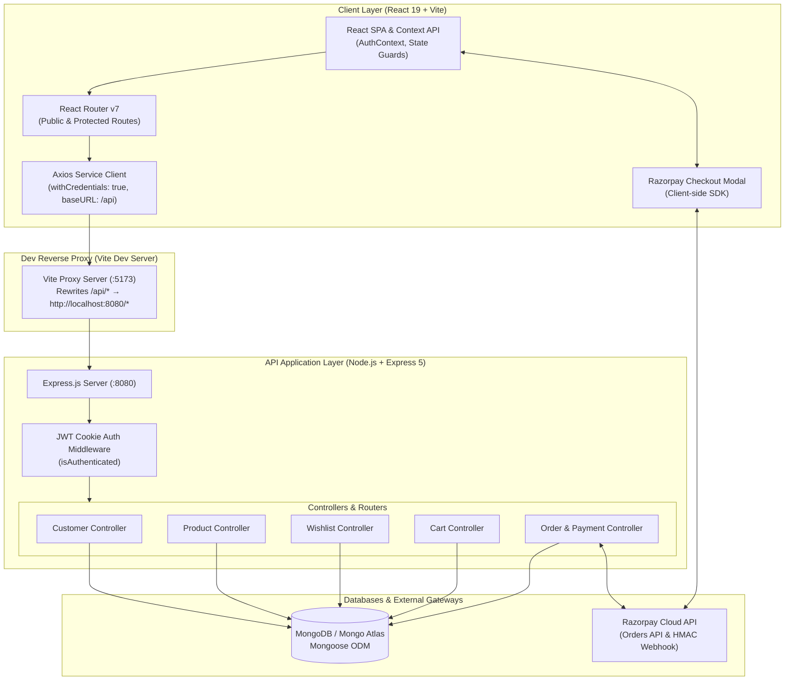
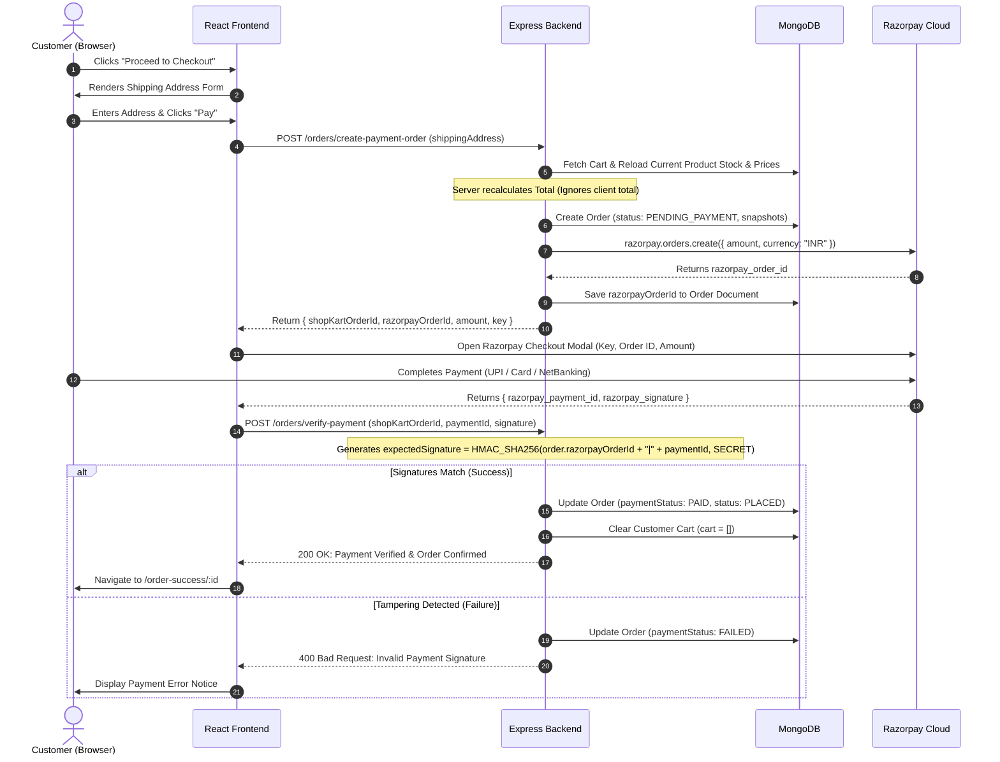

<div align="center">

# 🛒 ShopKart — Modern Full-Stack E-Commerce Engine

[](https://nodejs.org/)
[](https://expressjs.com/)
[](https://react.dev/)
[](https://vitejs.dev/)
[](https://mongoosejs.com/)
[](https://razorpay.com/)
[](https://jwt.io/)

<p align="center">
  <strong>A resilient, production-grade MERN e-commerce application featuring secure HTTP-only cookie authentication, live catalog discovery, persistent wishlist & cart management, and Razorpay payment integration verified via cryptographic HMAC-SHA256 signatures.</strong>
</p>

[Project Evolution](#-project-evolution--lab-journey) • [Key Features](#-key-features) • [System Architecture](#-system-architecture) • [Payment Workflow](#-payment--order-lifecycle) • [API Reference](#-complete-api-reference) • [Frontend Routes](#-frontend-routes--navigation) • [Getting Started](#-getting-started) • [Security](#-security-highlights)

---

</div>

## 📑 Table of Contents

- [Overview](#-overview)
- [Project Evolution & Lab Journey](#-project-evolution--lab-journey)
- [System Architecture](#-system-architecture)
- [Key Features](#-key-features)
- [Payment & Order Lifecycle](#-payment--order-lifecycle)
- [Complete API Reference](#-complete-api-reference)
  - [Authentication & Customer (`/customers`)](#1-authentication--customer-routes-customers)
  - [Product Catalog (`/products`)](#2-product-catalog-routes-products)
  - [Wishlist (`/wishlist`)](#3-wishlist-routes-wishlist)
  - [Cart (`/cart`)](#4-cart-routes-cart)
  - [Orders & Checkout (`/orders`)](#5-order--checkout-routes-orders)
- [Frontend Routes & Navigation](#-frontend-routes--navigation)
- [Data Models & Schema Architecture](#-data-models--schema-architecture)
- [Tech Stack](#-tech-stack)
- [Getting Started](#-getting-started)
  - [Prerequisites](#prerequisites)
  - [Backend Setup](#1-backend-setup)
  - [Frontend Setup](#2-frontend-setup)
  - [Database Seeding](#3-database-seeding)
- [Environment Variables](#-environment-variables)
- [Security Highlights](#-security-highlights)
- [Project Directory Structure](#-project-directory-structure)

---

## 🌟 Overview

**ShopKart** is an end-to-end e-commerce solution architected with modern industry standards. From zero-trust authentication using **tamper-proof HTTP-only cookies** and password hashing with **Bcrypt**, to **anti-tampering Razorpay order creation**, atomic inventory checks, and server-calculated totals, ShopKart delivers a snappy, seamless user experience without compromising on enterprise security or data integrity.

---

## 🎓 Project Evolution & Lab Journey

ShopKart was built progressively through a modular full-stack curriculum, expanding step-by-step from core authentication to a complete commerce and checkout platform:

* **Lab-01 & Lab-02 — Core MVC & Zero-Trust Authentication**:
  - Express.js MVC project setup and database connectivity.
  - User registration, Bcrypt password hashing (10 rounds), and login verification.
  - Stateless JWT issuance stored inside secure, tamper-proof `httpOnly` cookies with `sameSite: "lax"`.
  - Profile retrieval (`/customers/me`), session invalidation (`/customers/logout`), and secure password updates (`/customers/change-password`).
* **Lab-03 — Product Catalog, Live Discovery & Seed Scripting**:
  - MongoDB Product schema with strict bounds validation (`price > 0`, `stock >= 0`).
  - Automated seeding utility (`npm run seed`) creating initial catalog items.
  - Live, debounced search (`$regex` matching), category filtering, and dual-direction price sorting (`price_asc` / `price_desc`).
  - Single product detailed inspection page (`/products/:id`).
  - Comprehensive UI states: **Loading**, **Error**, and **Empty** states handled across all views.
* **Lab-04 & Lab-05 — Interactive Wishlist & Dynamic Cart Engine**:
  - Customer model relational arrays with Mongoose population.
  - Wishlist management with deduplication checks (`409 Conflict`) and seamless toggle endpoint.
  - Real-time shopping cart with inventory-bounded quantity management (`quantity <= stock`).
* **Lab-06 — Checkout Pipeline & Cryptographic Razorpay Integration**:
  - Shipping address capture with 10-digit phone and 6-digit postal code validation.
  - Server-side price recalculation and immutable purchase snapshots.
  - Two-stage Razorpay checkout modal orchestration with server-side HMAC-SHA256 signature verification.
  - Post-payment cart invalidation and full customer order tracking (`/orders`, `/orders/:id`).

---

## 🏛️ System Architecture



---

## ✨ Key Features

### 🔐 1. Authentication & Session Security
* **Zero-Trust Token Management**: JWT tokens are transmitted exclusively via `httpOnly`, `sameSite: "lax"` cookies, immunizing the client against XSS token theft.
* **Bcrypt Password Encryption**: Industry standard salt-hashing (10 rounds) protects user credentials at rest.
* **Strict Route Guards**: Granular `ProtectedRoute` and `PublicRoute` abstractions ensure unauthorized users cannot view protected store sections, and authenticated users bypass auth pages.
* **In-Session Password Modification**: Secure PATCH endpoint verifying old password prior to hashing new credentials.

### 🛍️ 2. Dynamic Product Discovery & Search
* **Real-time Filter & Search Engine**: Debounced live text search querying product titles with `$regex` case-insensitivity.
* **Category Filtering**: Instant categorization (`Electronics`, `Footwear`, `Accessories`, etc.).
* **Dynamic Sorting**: Price sorting (`price_asc`, `price_desc`) alongside default chronological ordering.
* **Stock Tracking**: Live inventory counts prevent out-of-stock orders before they begin.
* **Resilient UI States**: Full support for loading skeletons/spinners, contextual error messages, and empty state illustrations across the application.

### ❤️ 3. Saved Items & Wishlist
* **One-Click Toggle**: Smooth toggle mechanism allowing users to add or remove products seamlessly.
* **Conflict Prevention**: Built-in `409 Conflict` checks avoid duplicate saved entries.
* **Populated Relational Queries**: Wishlist items are dynamically populated with active product details (price, stock, image).

### 🛒 4. Real-Time Cart System
* **Inventory Capping**: Intelligent cart additions verify on-hand warehouse stock before allowing quantity increments.
* **Server-Validated Quantities**: Sanitized integer validation guarantees quantities cannot be negative or decimal.
* **Inline Line-Item Management**: Effortlessly increment, decrement, or purge items from the cart.

### 💳 5. Razorpay Payments & Cryptographic Verification
* **Zero Client Trust Pricing**: Client-side prices are completely discarded; server recalculates exact totals against real-time database product documents.
* **Purchasing Snapshots**: Product titles and prices are duplicated into the Order document as an immutable snapshot. Future changes to catalog pricing will never mutate historical order records.
* **HMAC-SHA256 Signature Verification**: Eliminates payment forgery by recalculating cryptographic signatures against the local server database order ID and Razorpay Secret.
* **Atomic Cart Invalidation**: Cart is wiped **only** after signature validation completes successfully.

### 📦 6. Order Tracking & Lifecycle Management
* **Status Progression Pipeline**: `PENDING_PAYMENT` ➔ `PLACED` ➔ `CONFIRMED` ➔ `SHIPPED` ➔ `DELIVERED`.
* **Access Control**: Users can exclusively read orders belonging to their own customer ID.
* **Shipping Metadata**: Validates 10-digit telephone and 6-digit postal codes upon submission.

---

## 🔄 Payment & Order Lifecycle



---

## 📚 Complete API Reference

Base URL: `http://localhost:8080` (the Vite development server proxies `/api/*` to it)

### 1. Authentication & Customer Routes (`/customers`)

| Method | Endpoint | Access | Body / Params | Description |
| :--- | :--- | :---: | :--- | :--- |
| `POST` | `/customers/register` | Public | `{ fullName, email, password, phone }` | Create new customer account |
| `POST` | `/customers/login` | Public | `{ email, password }` | Authenticate customer & set HTTP-only cookie |
| `GET` | `/customers/me` | Protected (✓) | _None_ | Retrieve authenticated customer profile |
| `POST` | `/customers/logout` | Protected (✓) | _None_ | Clear HTTP-only authentication cookie |
| `PATCH`| `/customers/change-password` | Protected (✓) | `{ oldPassword, newPassword }` | Verify existing password and hash new password |

---

### 2. Product Catalog Routes (`/products`)

| Method | Endpoint | Access | Parameters | Description |
| :--- | :--- | :---: | :--- | :--- |
| `POST` | `/products` | Public/Dev | Request Body (JSON) | Create product (201; 400 on validation errors) |
| `GET` | `/products` | Protected (✓) | Query params (`search`, `category`, `sort`) | List products with `{ success, count, products }` |
| `GET` | `/products/:id` | Protected (✓) | Product `id` (path) | Single product details (400 invalid ID, 404 not found) |

#### Query Parameters on `GET /products`:
- `search=<term>` — Case-insensitive regex match on product name (e.g. `search=keyboard`)
- `category=<category>` — Exact category filter (e.g. `category=Electronics`)
- `sort=price_asc` / `sort=price_desc` — Sort products ascending or descending by price

**Query Examples:**
```http
GET /products?search=phone
GET /products?category=Electronics
GET /products?search=phone&category=Electronics
GET /products?sort=price_asc
```

#### Create Product Payload Schema (`POST /products`):
```json
{
  "name": "Mechanical Keyboard",
  "description": "RGB mechanical keyboard with blue switches.",
  "price": 2999,
  "category": "Electronics",
  "image": "https://example.com/keyboard.jpg",
  "stock": 10
}
```
*Validation Rules*: All fields are required. `price > 0`, `stock >= 0`. `createdAt` and `updatedAt` are automatically generated.

---

### 3. Wishlist Routes (`/wishlist`)

| Method | Endpoint | Access | Params | Description |
| :--- | :--- | :---: | :--- | :--- |
| `GET` | `/wishlist` | Protected (✓) | _None_ | Retrieve user's saved wishlist items with populated details |
| `POST` | `/wishlist/:productId` | Protected (✓) | `productId` | Add product to wishlist (`409 Conflict` if already present) |
| `DELETE`| `/wishlist/:productId` | Protected (✓) | `productId` | Remove specific product from wishlist |
| `PATCH` | `/wishlist/:productId/toggle`| Protected (✓) | `productId` | Toggle product presence in user wishlist (`{ saved: true/false }`) |

---

### 4. Cart Routes (`/cart`)

| Method | Endpoint | Access | Body / Params | Description |
| :--- | :--- | :---: | :--- | :--- |
| `GET` | `/cart` | Protected (✓) | _None_ | Get populated cart with live product documents |
| `POST` | `/cart/:productId` | Protected (✓) | `productId` | Add item (qty 1) or increment quantity (bounds-checked against stock) |
| `PATCH`| `/cart/:productId` | Protected (✓) | `{ quantity }` | Update quantity for item (`quantity >= 1`, `<= stock`) |
| `DELETE`| `/cart/:productId` | Protected (✓) | `productId` | Remove specific item completely from cart |

---

### 5. Order & Checkout Routes (`/orders`)

| Method | Endpoint | Access | Payload | Description |
| :--- | :--- | :---: | :--- | :--- |
| `POST` | `/orders/create-payment-order` | Protected (✓) | `{ shippingAddress }` | Validates stock, locks prices into snapshot, generates Razorpay Order |
| `POST` | `/orders/verify-payment` | Protected (✓) | `{ shopKartOrderId, razorpay_order_id, razorpay_payment_id, razorpay_signature }` | Cryptographic HMAC-SHA256 signature verification; marks order PAID & empties cart |
| `GET` | `/orders` | Protected (✓) | _None_ | List all historical orders belonging to logged-in customer |
| `GET` | `/orders/:id` | Protected (✓) | `id` | Retrieve single order details with ownership verification |
| `PATCH`| `/orders/:id/status` | Protected (✓) | `{ status }` | Progress status (`PLACED`, `CONFIRMED`, `SHIPPED`, `DELIVERED`) |

---

## 🧭 Frontend Routes & Navigation

The frontend client utilizes React Router v7 with dedicated Route Guard wrappers to provide seamless, secure navigation:

| Route | Page Component | Access Type | Purpose |
| :--- | :--- | :---: | :--- |
| `/login` | `Login.jsx` | Public | Customer login form (sets auth cookie) |
| `/register` | `Register.jsx` | Public | New account registration form |
| `/` | Redirect | — | Redirects root to `/login` |
| `/home` | `Home.jsx` | Protected | Dashboard and welcome portal |
| `/products` | `Products.jsx` | Protected | Dynamic catalog grid with live search, filters, & sorting |
| `/products/:id` | `ProductDetails.jsx` | Protected | Single product detailed view, specs, & add-to-cart |
| `/wishlist` | `Wishlist.jsx` | Protected | Saved items gallery with quick remove/move-to-cart |
| `/cart` | `Cart.jsx` | Protected | Cart review, item quantity adjustments, and subtotal summary |
| `/checkout` | `Checkout.jsx` | Protected | Shipping address entry form and Razorpay modal checkout trigger |
| `/order-success/:id` | `OrderSuccess.jsx`| Protected | Post-payment confirmation with order ID and summary |
| `/orders` | `Orders.jsx` | Protected | Historical orders listing with status tracking badges |
| `/orders/:id` | `OrderDetails.jsx` | Protected | Full order breakdown, shipping address, and tracking status |

> [!NOTE]
> **API Collision Protection**: The frontend calls `/api/products`, `/api/cart`, etc., and the Vite development server proxy automatically rewrites `/api/*` ➔ backend (`http://localhost:8080/*`). This ensures that client page routes like `/products` never collide with API endpoints.

---

## 🗄️ Data Models & Schema Architecture

```
┌─────────────────────────────────┐       ┌─────────────────────────────────┐
│            Customer             │       │             Product             │
├─────────────────────────────────┤       ├─────────────────────────────────┤
│ _id: ObjectId                   │       │ _id: ObjectId                   │
│ fullName: String                │       │ name: String                    │
│ email: String (unique)          │       │ description: String             │
│ password: String (bcrypt hash)  │       │ price: Number (min 0.01)        │
│ phone: String                   │       │ category: String                │
│ wishlist: [ObjectId -> Product] │       │ image: String (URL)             │
│ cart: [                         │       │ stock: Number (min 0)           │
│   {                             │       │ timestamps: true                │
│     product: ObjectId -> Prod,  │       └─────────────────────────────────┘
│     quantity: Number (default 1)│                        │
│   }                             │                        │ (Snapshot items)
│ ]                               │                        ▼
│ timestamps: true                │       ┌─────────────────────────────────┐
└─────────────────────────────────┘       │              Order              │
                 │                        ├─────────────────────────────────┤
                 │                        │ _id: ObjectId                   │
                 │ 1-to-N                 │ user: ObjectId -> Customer      │
                 └───────────────────────►│ items: [                        │
                                          │   {                             │
                                          │     product: ObjectId -> Prod,  │
                                          │     name: String (Snapshot),    │
                                          │     price: Number (Snapshot),   │
                                          │     quantity: Number,           │
                                          │     image: String               │
                                          │   }                             │
                                          │ ],                              │
                                          │ shippingAddress: { ... },       │
                                          │ totalAmount: Number,            │
                                          │ paymentStatus: PENDING|PAID|FAIL│
                                          │ status: PENDING_PAYMENT|PLACED..│
                                          │ razorpayOrderId: String,        │
                                          │ razorpayPaymentId: String,      │
                                          │ timestamps: true                │
                                          └─────────────────────────────────┘
```

---

## 🛠️ Tech Stack

| Domain | Technology | Purpose |
| :--- | :--- | :--- |
| **Backend Runtime** | Node.js (v18+) | Server-side JavaScript execution environment (ES Modules) |
| **Framework** | Express.js v5.2.1 | Minimalist, robust REST API routing framework |
| **Database** | MongoDB & Mongoose v9.9.3 | NoSQL document store with strict Mongoose schema validation |
| **Authentication** | JSON Web Tokens (`jsonwebtoken`) | Stateless authentication claims transmitted via HTTP-only cookies |
| **Encryption** | Bcrypt v6.0.0 | One-way password salt-hashing algorithm |
| **Payment Gateway** | Razorpay SDK v2.9.8 | Payment order orchestration & secure HMAC-SHA256 signature verification |
| **Frontend UI** | React 19 (`react`, `react-dom`) | Modern reactive user interface rendering |
| **Routing** | React Router DOM v7 | Declarative single-page app route navigation & layout guards |
| **Bundler & Dev Server**| Vite v6.0 | Lightning-fast HMR and automated API proxying (`/api` -> Express) |
| **HTTP Client** | Axios | Promise-based HTTP client preconfigured for cross-origin credentials |

---

## 🚀 Getting Started

### Prerequisites

Ensure you have the following installed on your machine:
* [Node.js](https://nodejs.org/) `>= 18.x`
* [npm](https://www.npmjs.com/) `>= 9.x`
* [MongoDB](https://www.mongodb.com/try/download/community) installed locally or a [MongoDB Atlas](https://www.mongodb.com/cloud/atlas) cluster URI.
* A Razorpay Test Account ([Sign Up](https://dashboard.razorpay.com/)) to generate API keys.

---

### 1. Backend Setup

```bash
# Navigate into backend directory
cd backend

# Install dependencies
npm install

# Create environment configuration from template
cp .env.example .env
```

Configure your `backend/.env` file:
```env
PORT=8080
MONGO_URI=mongodb://localhost:27017/shopkart
JWT_SECRET=shopkart_secret_key
RAZORPAY_KEY_ID=rzp_test_YourKeyId
RAZORPAY_KEY_SECRET=YourKeySecret
```

> [!TIP]
> **MongoDB Atlas Cloud Connection**:  
> To use MongoDB Atlas instead of a local instance, paste your `mongodb+srv://...` URI into `MONGO_URI`. Ensure your client IP is whitelisted under **Atlas ➔ Security ➔ Network Access**.

Start the backend in development mode with automatic restart on save:
```bash
npm run dev
# Server runs on http://localhost:8080
```

---

### 2. Frontend Setup

In a separate terminal window:

```bash
# Navigate into frontend directory
cd frontend

# Install dependencies
npm install

# Start Vite dev server
npm run dev
# Opens on http://localhost:5173
```

> **Note on Dev Server Proxy**:  
> The Vite development server automatically proxies any request matching `/api/*` to the backend. If your backend uses port `8080`, ensure `frontend/vite.config.js` points to `http://localhost:8080`.

---

### 3. Database Seeding

Seed the database with 10 sample products across multiple categories:

```bash
cd backend
npm run seed
```

This runs `utils/seedProducts.js`, establishing a rich demo inventory immediately ready for search, cart, and checkout operations.

---

## 🔒 Security Highlights

1. **Anti-XSS Cookie Architecture**:
   Tokens are stored in cookies with flags:
   ```javascript
   {
     httpOnly: true, // Inaccessible to document.cookie (immunizes against XSS)
     sameSite: "lax", // Protects against cross-site request forgery (CSRF)
     secure: false    // Set to true in HTTPS production
   }
   ```
2. **Anti-Tampering Payment Math**:
   Clients can manipulate prices via DevTools. ShopKart completely ignores incoming client prices and recalculates every order sum directly from current database product records.
3. **Cryptographic Webhook/Callback Verification**:
   Payments cannot be spoofed by fabricating IDs:
   ```javascript
   const body = order.razorpayOrderId + "|" + razorpay_payment_id;
   const expectedSignature = crypto
     .createHmac("sha256", process.env.RAZORPAY_KEY_SECRET)
     .update(body)
     .digest("hex");
   ```
4. **Data Immutability via Historical Snapshots**:
   Orders retain exact item names and prices locked at checkout time. Future storewide price updates never distort accounting or previous order histories.

---

## 📁 Project Directory Structure

```text
ShopKart/
├── .env.example                # Root environment variable template
├── .gitignore                  # Git ignore rules for node_modules, .env, build output
├── README.md                   # Complete project documentation & architecture manual
│
├── backend/
│   ├── config/
│   │   └── razorpay.js         # Lazy-loaded Razorpay client initialization
│   ├── controllers/
│   │   ├── cart.controller.js      # Cart CRUD & stock bounding
│   │   ├── customer.controller.js  # Auth (register, login, profile, password)
│   │   ├── order.controller.js     # Payment initiation & HMAC verification
│   │   ├── product.controller.js   # Catalog queries, search, filter & sorting
│   │   └── wishlist.controller.js  # Wishlist CRUD & state toggling
│   ├── middlewares/
│   │   └── auth.middleware.js      # JWT cookie verification & user injection
│   ├── models/
│   │   ├── customer.model.js       # Customer schema, cart & wishlist subdocs
│   │   ├── order.model.js          # Order schema with immutable snapshots
│   │   └── product.model.js        # Catalog product schema
│   ├── routes/
│   │   ├── cart.routes.js          # /cart endpoints
│   │   ├── customer.routes.js      # /customers endpoints
│   │   ├── order.routes.js         # /orders endpoints
│   │   ├── product.routes.js       # /products endpoints
│   │   └── wishlist.routes.js      # /wishlist endpoints
│   ├── utils/
│   │   ├── generateToken.js        # JWT token generation helper
│   │   ├── migrateToAtlas.js       # Local-to-Atlas migration utility
│   │   └── seedProducts.js         # Demo catalog populator
│   ├── .env                        # Local backend environment variables (gitignored)
│   ├── .env.example                # Backend environment template (same location as .env)
│   ├── index.js                    # Express app root & DB connection setup
│   ├── package.json                # Backend dependencies & run scripts
│   └── package-lock.json
│
└── frontend/
    ├── src/
    │   ├── components/
    │   │   ├── Navbar.jsx          # Dynamic nav with cart/wishlist badges
    │   │   ├── ProductCard.jsx     # Reusable product display card
    │   │   ├── ProtectedRoute.jsx  # Auth guard for authenticated views
    │   │   ├── PublicRoute.jsx     # Auth guard for guest views
    │   │   └── SearchBar.jsx       # Debounced catalog search input
    │   ├── context/
    │   │   └── AuthContext.jsx     # Global authentication provider
    │   ├── pages/
    │   │   ├── Cart.jsx            # Cart review & quantity modification
    │   │   ├── Checkout.jsx        # Shipping form & Razorpay payment launcher
    │   │   ├── Home.jsx            # Landing / Dashboard view
    │   │   ├── Login.jsx           # User sign-in interface
    │   │   ├── OrderDetails.jsx    # Single order inspection & timeline
    │   │   ├── Orders.jsx          # Order history listing
    │   │   ├── OrderSuccess.jsx    # Order confirmation screen
    │   │   ├── ProductDetails.jsx  # Detailed product view & specifications
    │   │   ├── Products.jsx        # Catalog listing with filters & sort
    │   │   ├── Register.jsx        # Account registration
    │   │   └── Wishlist.jsx        # Saved products gallery
    │   ├── services/
    │   │   └── api.js              # Centralized Axios service with API methods
    │   ├── App.jsx                 # Application route registry
    │   ├── main.jsx                # React root mount & context wrapper
    │   └── style.css               # Comprehensive responsive styling
    ├── index.html                  # HTML entrypoint with Razorpay SDK script
    ├── vite.config.js              # Vite bundler config with /api proxy
    ├── package.json                # Frontend dependencies & run scripts
    └── package-lock.json
```

---

<div align="center">
  <sub>Built with ❤️ for scalable, secure e-commerce development.</sub>
</div>
